# Flutter Custom Updater

📦 A Flutter package for internal app updates (APK & IPA). Update your apps from your own server without App Store or Play Store. Built for self-hosted, enterprise, and private app distribution.

## ✨ Features

### 🌐 Cross-Platform Support

| Platform | Format | Installation Method                                | Status       |
| -------- | ------ | -------------------------------------------------- | ------------ |
| Android  | APK    | Automatic download and installation                | ✅ Supported |
| iOS      | IPA    | Enterprise distribution via itms-services protocol | ✅ Supported |

### 🎯 Core Features

- 🎨 **Three Dialog Styles** - Material 3, Cupertino, and bottom sheet designs
- 🌗 **Theme-Aware** - Follows your app's `ColorScheme`, including dark mode
- 📝 **Formatted Release Notes** - `-` / `*` / `•` lines render as bullets, `Heading:` lines are emphasised
- 📱 **Cross-Platform** - Works on both Android and iOS
- 🔄 **Automatic Updates** - Version checking, downloading, and installation
- 📊 **Download Progress** - Live progress bar with size and percentage, plus Cancel
- 🔁 **Retry on Failure** - Failed downloads and installs offer Retry instead of a dead end
- 🛡️ **Install Permission Guidance** - Explains Android's "install unknown apps" setting and opens it for the user
- ⚡ **Force Updates** - "Required update" badge, no dismiss/cancel, and the app stays blocked until the update is installed
- 🌐 **Language Header Support** - Send custom language codes in API requests
- 🎯 **Fully Customizable** - Colors, text, styles, and callbacks
- 🚀 **Self-Hosted** - Complete control with your own update server

## 📸 Screenshots

| Platform | Material | Cupertino | Bottom sheet |
| :---: | :---: | :---: | :---: |
| **Android** | 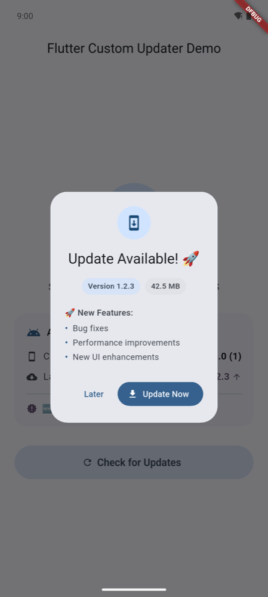 | 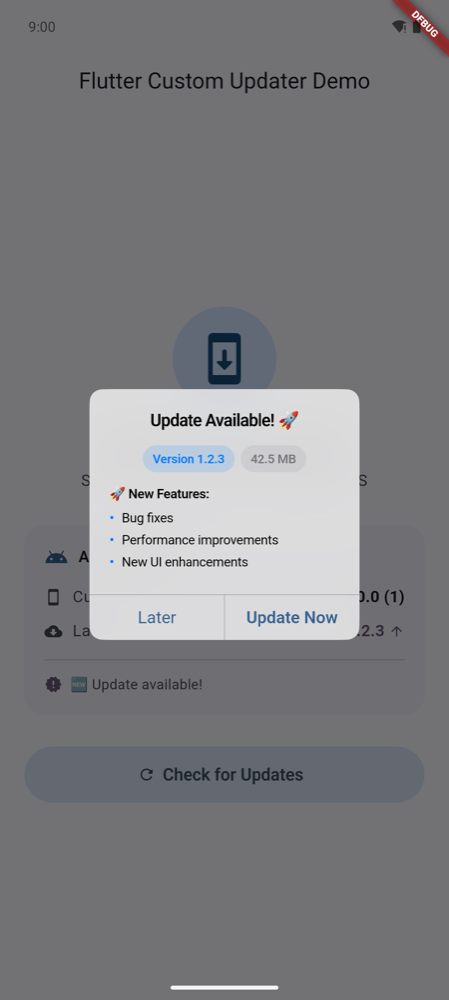 | 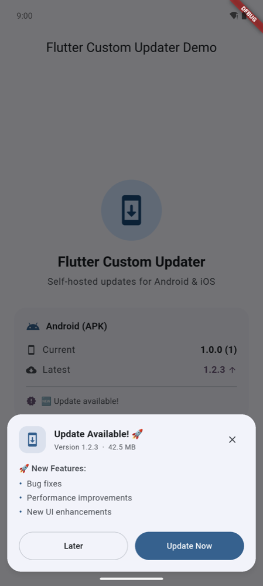 |
| **Android** (downloading) | 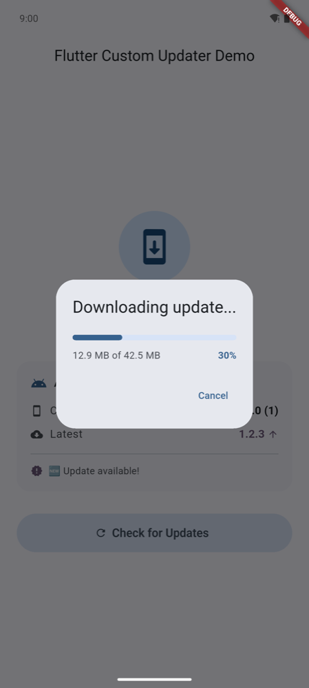 | 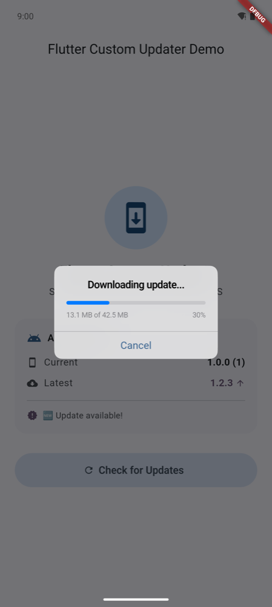 | 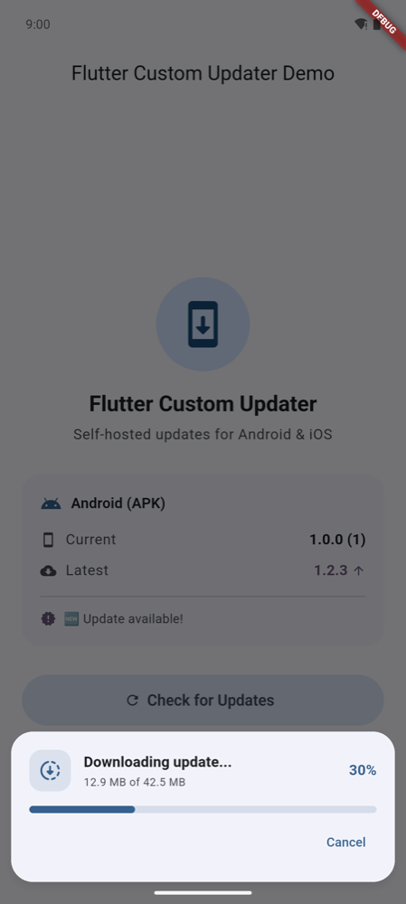 |
| **iOS** | 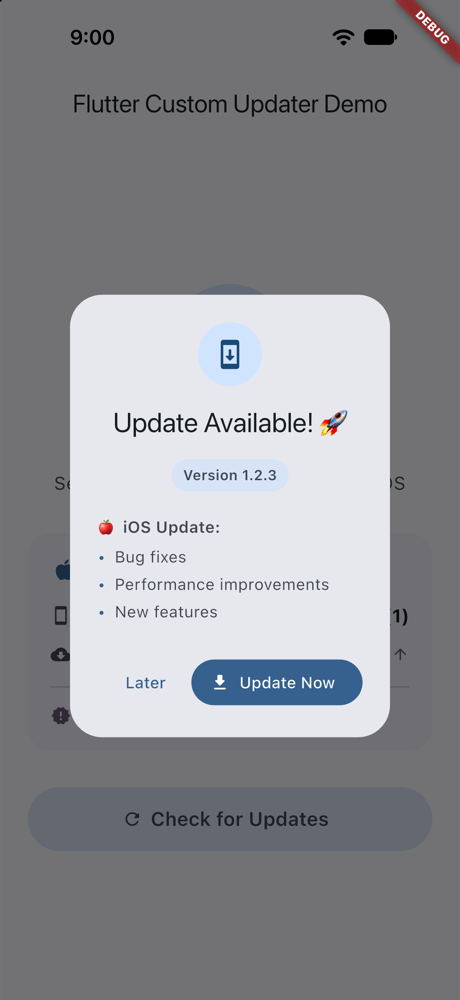 | 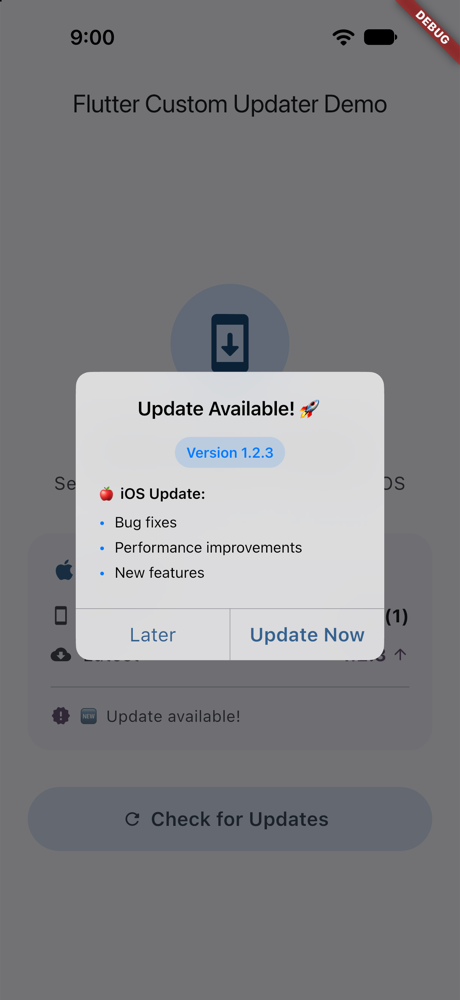 | 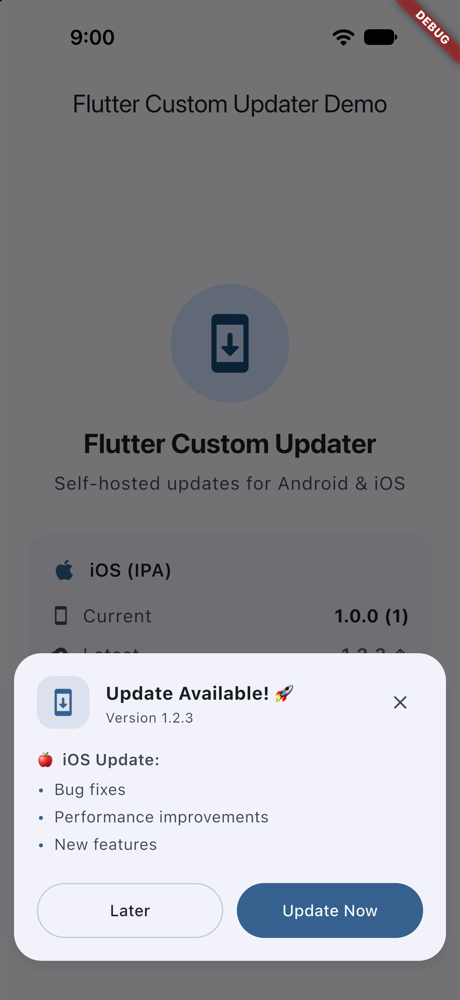 |
| **iOS** (installing) | 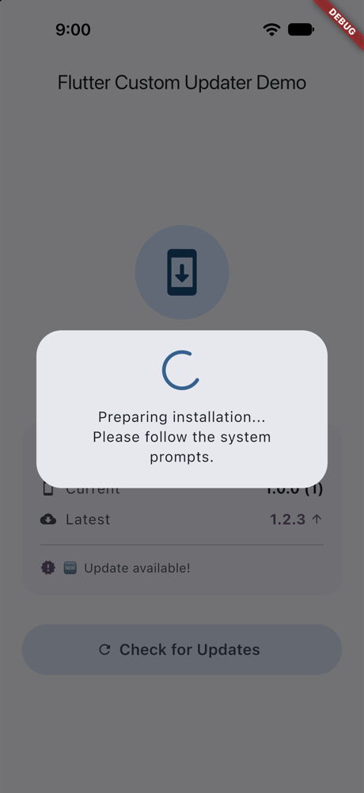 | 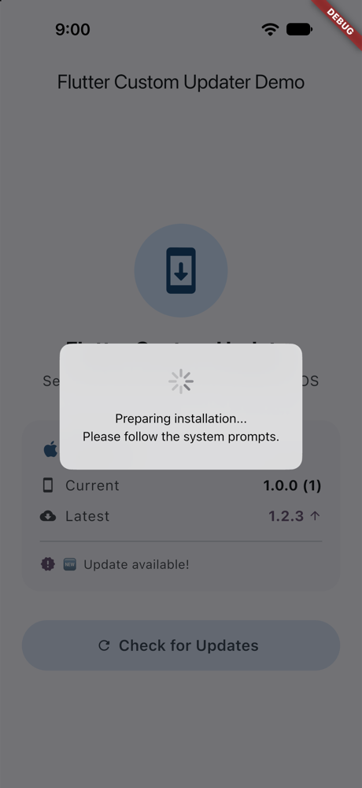 | 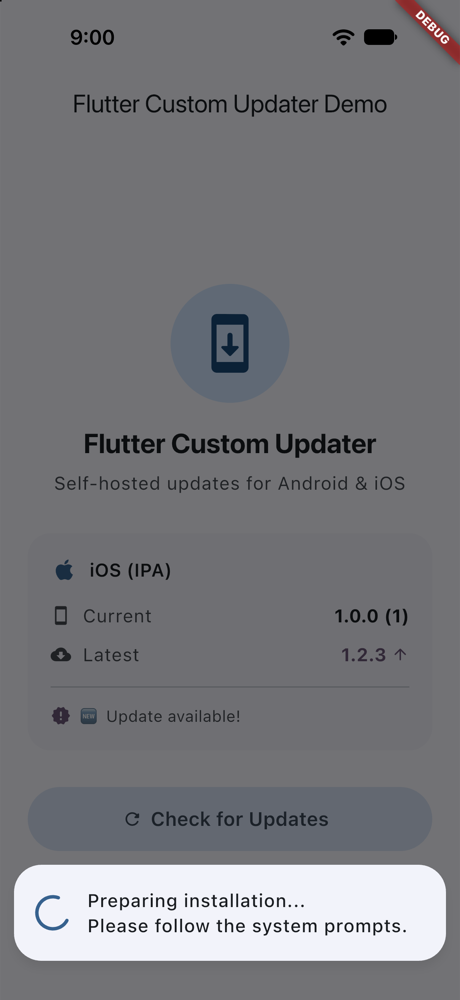 |

### Other states

Every state is drawn in the dialog style you choose (Material shown here).

| Required update | Install permission (Android) | Download failed | Finish updating (forced) |
| :---: | :---: | :---: | :---: |
| 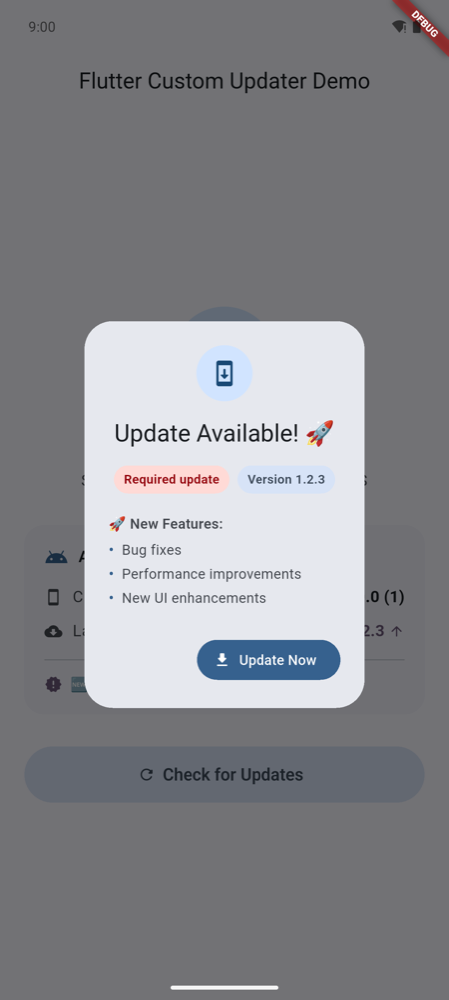 | 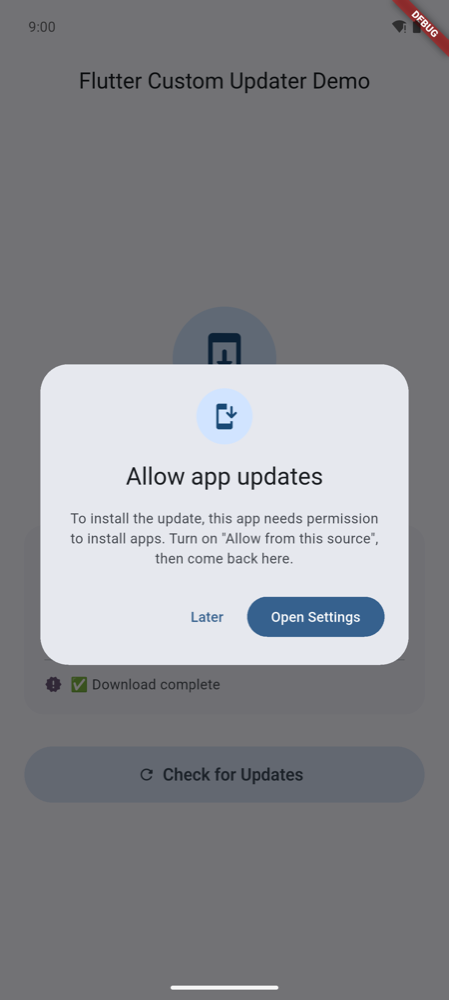 | 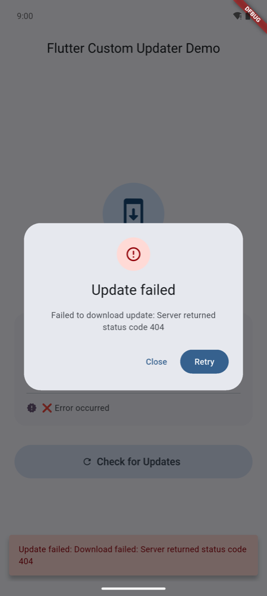 | 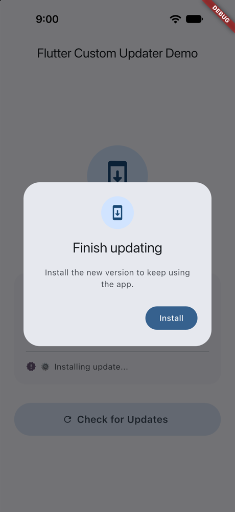 |

### Dark mode

The dialogs pick up your app's dark `ColorScheme` automatically.

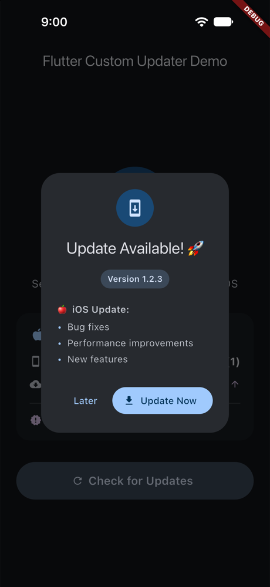 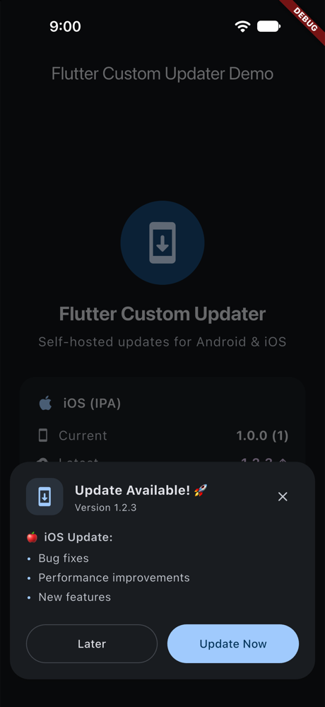

> 💡 To try each style in the example app: `flutter run --dart-define=DIALOG_STYLE=cupertino` (`material` | `cupertino` | `bottomSheet`).

## 📦 Installation

Requires Dart 3.9+ (Flutter 3.35+).

Install directly from GitHub (always get the latest):

```
dependencies:
  flutter_custom_updater:
    git:
      url: https://github.com/vatanakchamroeun/flutter_custom_updater.git
```

or install to your local

```
dependencies:
  flutter_custom_updater:
    path: ../flutter_custom_updater
```

> ⬆️ **Upgrading from 1.x?** A few options were renamed in 2.0.0. The old names
> still work but show deprecation warnings. See the [CHANGELOG](CHANGELOG.md#200).

## ⚙️ Setup

### 🤖 Android Setup

Add these permissions to `android/app/src/main/AndroidManifest.xml`:

```xml
<manifest>
    <uses-permission android:name="android.permission.INTERNET"/>
    <uses-permission android:name="android.permission.REQUEST_INSTALL_PACKAGES"/>
    ...
</manifest>
```

That's all: no storage permissions or `FileProvider` setup are needed. The APK is
downloaded to app-specific storage and handed to the system installer for you.

On Android 8.0+ the user must also allow your app to "install unknown apps".
The package checks this before opening the installer and, if needed, explains
why and opens the right Settings screen.

### 🍎 iOS Setup

Edit ios/Runner/Info.plist and add this inside the <dict> tag:

```
<key>LSApplicationQueriesSchemes</key>
<array>
    <string>itms-services</string>
</array>
```

## 🚀 Usage

### Basic Example

```dart
import 'package:flutter_custom_updater/flutter_custom_updater.dart';

final updater = AppUpdater(
  context: context,
  config: UpdaterConfig(
    updateCheckUrl: 'https://your-server.com/api/check-update',

    // Optional: Add custom headers
    customHeaders: {'Authorization': 'Bearer YOUR_TOKEN'},

    // Optional: Customize dialog style
    dialogStyle: DialogStyle.bottomSheet, // material, cupertino, or bottomSheet
  ),
);

await updater.checkAndUpdate();
```

### Advanced Customization

```dart
final updater = AppUpdater(
  context: context,
  config: UpdaterConfig(
    updateCheckUrl: 'https://your-server.com/api/check-update',

    // Dialog Style
    dialogStyle: DialogStyle.material, // Choose: material, cupertino, or bottomSheet

    // Language (auto-detects from device if not provided)
    language: 'km', // example: 'en', 'km', 'zh', etc.

    // UI Customization
    dialogTitle: 'New Update Available',
    dialogContent: 'A new version is ready to install',
    updateButtonText: 'Update Now',
    laterButtonText: 'Later',
    allowDismiss: true, // tap outside / back button closes optional updates

    // Timeouts
    checkTimeout: Duration(seconds: 30), // update check (default 30s)
    downloadTimeout: Duration(minutes: 5), // whole APK download (default 5 min)

    // Styling (defaults follow your app's theme)
    dialogTitleStyle: TextStyle(fontWeight: FontWeight.bold),
    dialogContentStyle: TextStyle(fontSize: 14),
    buttonTextStyle: TextStyle(fontWeight: FontWeight.w600),
    updateButtonStyle: FilledButton.styleFrom(backgroundColor: Colors.indigo),
    laterButtonStyle: TextButton.styleFrom(foregroundColor: Colors.grey),

    // Bottom sheet style
    sheetBackgroundColor: Colors.white,
    sheetAccentColor: Colors.blue, // icon and buttons
    sheetDescription: 'Get the latest features and improvements',

    // iOS-specific
    iosInstallText: 'Preparing installation...\nPlease follow the prompts.',

    // More text (all optional, English by default) - handy for translations
    versionText: 'Version {version}',
    requiredUpdateText: 'Required update',
    downloadingText: 'Downloading update...',
    downloadProgressText: '{received} of {total}',
    cancelButtonText: 'Cancel',
    retryButtonText: 'Retry',
    errorTitle: 'Update failed',
    closeButtonText: 'Close',
    installPermissionTitle: 'Allow app updates',
    installPermissionMessage: 'Turn on "Allow from this source", then come back here.',
    openSettingsButtonText: 'Open Settings',
    installPendingTitle: 'Finish updating',
    installPendingMessage: 'Install the new version to keep using the app.',
    installButtonText: 'Install',

    // Callbacks
    onNoUpdateAvailable: () => print('✅ App is up to date'),
    onError: (error) => print('❌ Error: $error'),
    onDownloadComplete: (path) => print('📥 Downloaded to: $path'),
    onInstallStart: () => print('🚀 Installing update...'),
  ),
);

await updater.checkAndUpdate();
```

## 🔧 Server Response Format

Your update check endpoint should return JSON in this format. The fields can be
wrapped in a `data` object (as below) or sent at the top level.

### Android Response

```json
{
  "status": "success",
  "code": 200,
  "message": "Update available",
  "data": {
    "has_update": true,
    "version": "1.2.3",
    "download_url": "https://your-server.com/downloads/app-v1.2.3.apk",
    "file_name": "app-v1.2.3.apk",
    "release_notes": "🚀 New Features:\n- Bug fixes\n- Performance improvements\n- New UI enhancements",
    "force_update": false,
    "file_size": 44231891
  }
}
```

### iOS Response

```json
{
  "status": "success",
  "code": 200,
  "message": "Update available",
  "data": {
    "has_update": true,
    "version": "1.2.3",
    "download_url": "https://your-server.com/ios/manifest.plist",
    "ios_manifest_url": "https://your-server.com/ios/manifest.plist",
    "release_notes": "🍎 iOS Update:\n- Bug fixes\n- Performance improvements\n- New features",
    "force_update": false
  }
}
```

### Field Reference

#### Required Fields:

| Field          | Type    | Description                                                                         |
| -------------- | ------- | ----------------------------------------------------------------------------------- |
| `has_update`   | boolean | Whether an update is available (defaults to `false` if missing)                     |
| `download_url` | string  | URL to download the APK or iOS manifest.plist (defaults to empty string if missing) |

#### Optional Fields:

| Field              | Type    | Description                                                  |
| ------------------ | ------- | ------------------------------------------------------------ |
| `version`          | string  | New version number to display                                |
| `release_notes`    | string  | What's new; `\n` line breaks, `- ` bullets and `Heading:` lines are formatted |
| `force_update`     | boolean | Require the update (see [Force Update](#force-update), defaults to `false`) |
| `file_name`        | string  | Custom filename for downloaded file (Android only)           |
| `file_size`        | integer | Size in bytes, shown to the user; also used for progress if the download has no `Content-Length` (Android only) |
| `ios_manifest_url` | string  | URL to .plist manifest for iOS enterprise distribution       |

### Platform Detection

The package automatically sends these headers with each update check:

- `Current-Version`: The current app version (e.g. `1.0.0`)
- `Platform`: Either `android` or `ios`
- `Accept-Language`: `language` from the config, or the device language (e.g. `km`), so your server can return translated release notes

Your server decides whether an update is available and replies with `has_update`.
Headers from `customHeaders` are added too (and override these if the names match).

### Force Update

Set `force_update: true` in your server response to require updates. The user then:

- sees a **Required update** badge and no "Later" button,
- can't cancel the download, and failures only offer **Retry**,
- stays blocked by a **Finish updating** prompt if they back out of the system installer.

```jsonc
// Your server should return this when force update is needed:
{
  "has_update": true,
  "version": "1.2.3",
  "force_update": true,  // Blocks the app until the update is installed
  "download_url": "https://your-server.com/downloads/app-v1.2.3.apk",
  "release_notes": "Critical security update. Please install immediately."
}
```

## 🧪 Try It Locally

The repo includes a mock update server and an example app:

```bash
cd mock_server && npm install && node server.js
cd example && flutter run
```

Start the server with `SLOW_DOWNLOAD_KBPS=2048` to watch the progress bar, or
`FORCE_UPDATE=1` to try a required update. See [mock_server/README.md](mock_server/README.md).

## ⚠️ Important Notes

### Android

- Users must allow your app to "install unknown apps"; the package guides them to the setting (Android 8.0+)
- The app needs the `REQUEST_INSTALL_PACKAGES` permission in its manifest
- APK files must be signed with the same certificate as your published app
- Serve the update check and APK over HTTPS in production: anything fetched over plain `http://` can be tampered with on the way (plain HTTP is fine for local testing with the mock server)

### iOS

- **Enterprise Distribution**: Requires an Apple Enterprise Developer Account ($299/year)
- **TestFlight/App Store**: For standard distribution, redirect users to TestFlight or App Store instead of using this package
- The manifest.plist file must be served over HTTPS
- Users may need to trust the enterprise certificate in Settings

## 🤝 Contributing

Contributions are welcome! Please read our [Contributing Guidelines](CONTRIBUTING.md) and feel free to submit a Pull Request.

## 📄 License

This project is licensed under the MIT License - see the [LICENSE](LICENSE) file for details.
